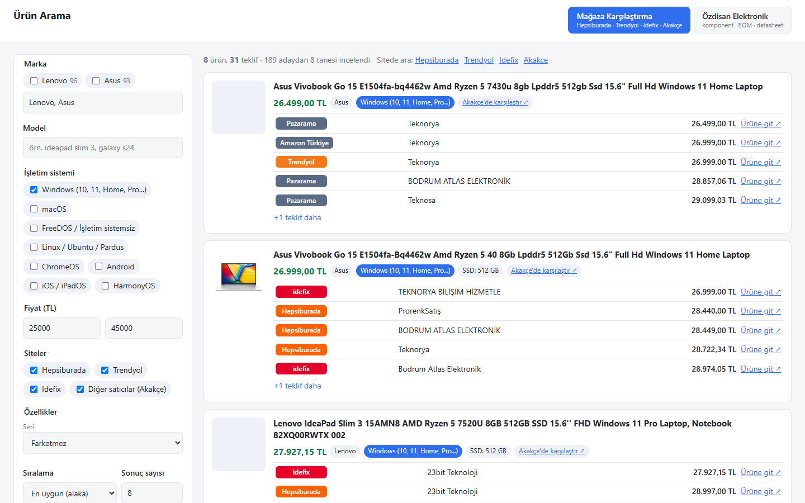
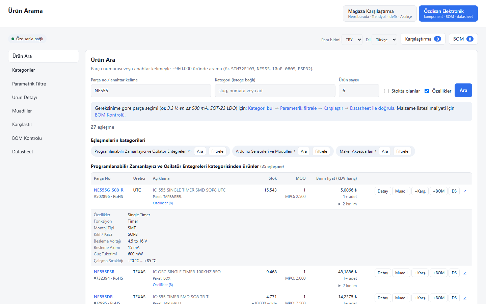
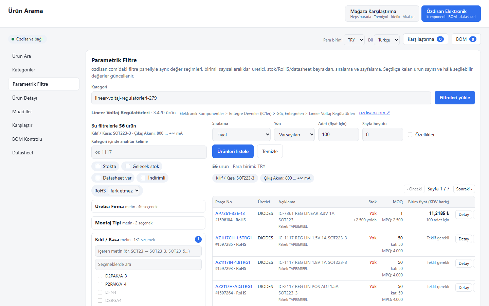
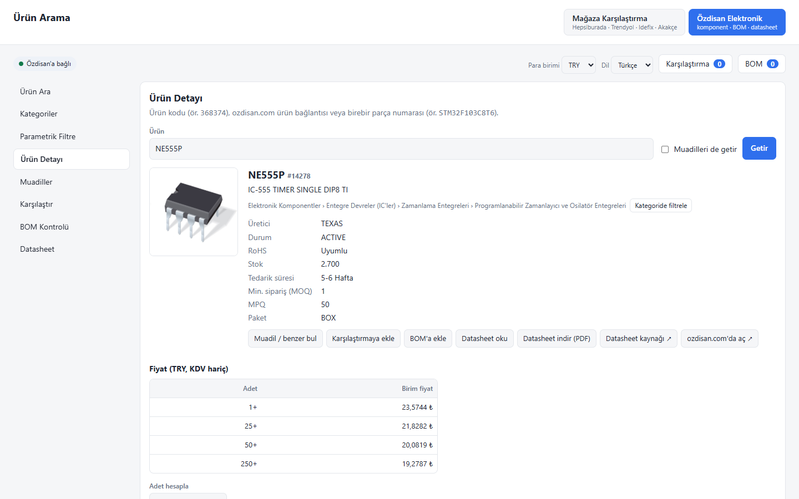
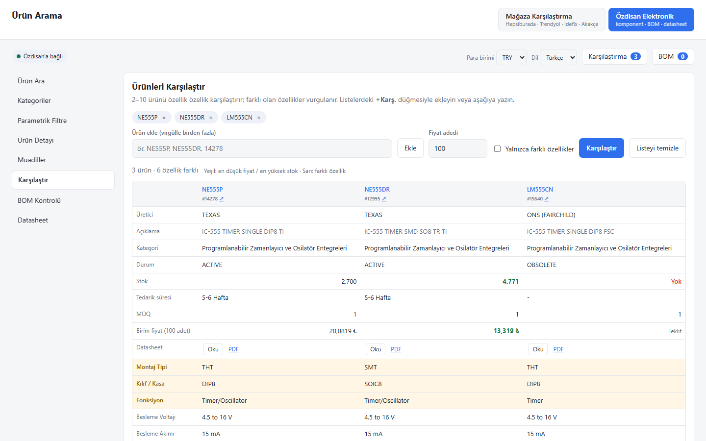
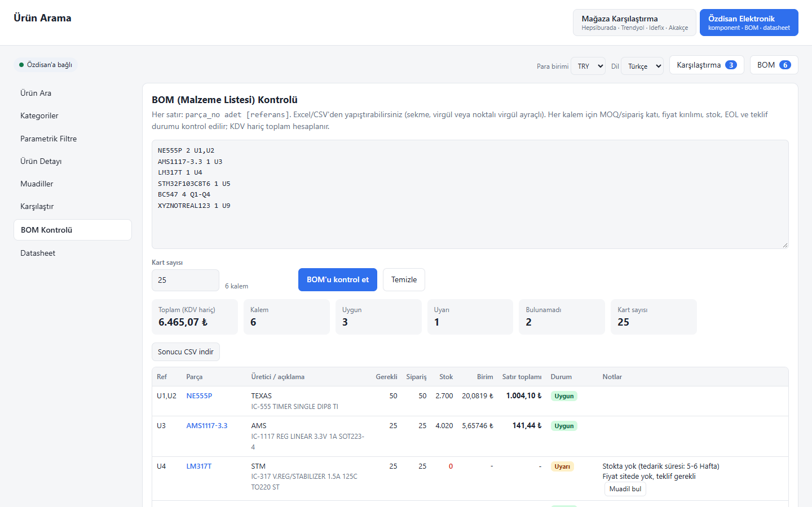
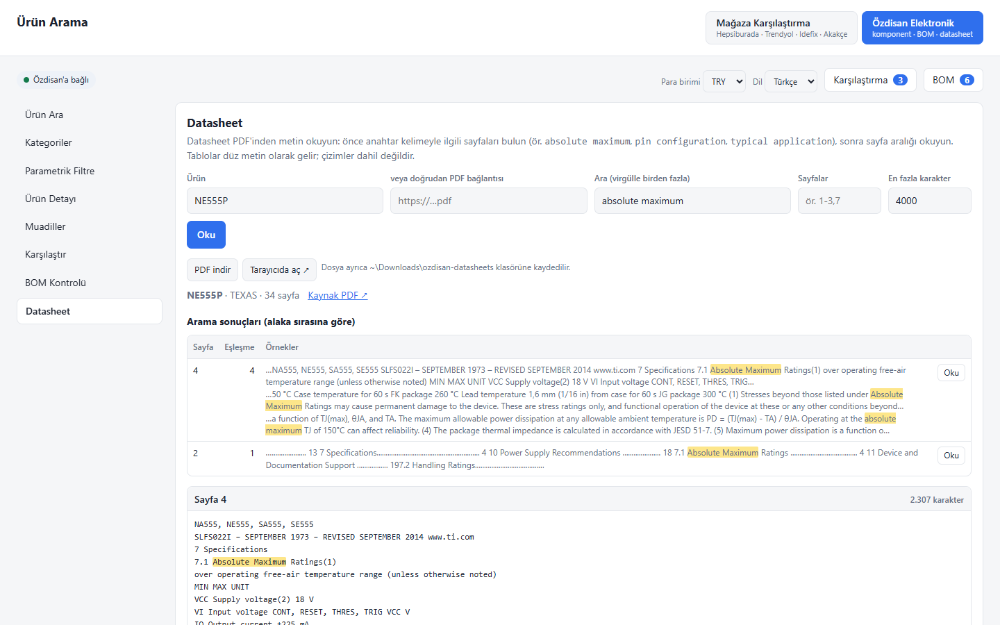
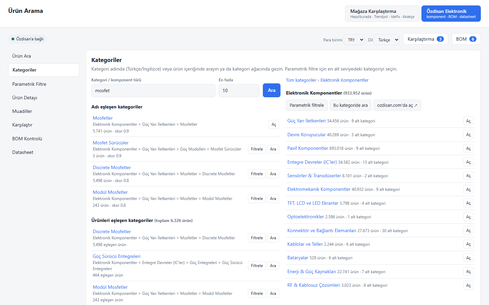

# Ürün Arama

Bilgisayarınızda çalışan bir web uygulaması. İki bölümü var:

- **Mağaza Karşılaştırma:** Hepsiburada, Trendyol, Idefix ve Akakçe'de ürün arar. Fiyat, marka, model, işletim sistemi
  ve özellik (RAM, SSD, dahili hafıza, ekran boyutu…) filtrelerini uygular, teklifleri satıcı linkleriyle listeler.
- **Özdisan Elektronik:** [ozdisan.com](https://www.ozdisan.com) kataloğunda (~960.000 elektronik komponent) arama,
  parametrik filtreleme, ürün detayı, muadil bulma, karşılaştırma, BOM maliyetlendirme ve datasheet okuma/indirme.



## Ekran görüntüleri

### Mağaza Karşılaştırma

Ürün adı, marka, işletim sistemi, fiyat aralığı ve site seçilir. Her ürün için satıcı teklifleri fiyata göre sıralanır;
**Ürüne git** bağlantısı satıcının sayfasını açar. Yukarıdaki görüntü: Windows'lu Lenovo/Asus laptoplar, 25.000–45.000 TL.

### Özdisan Elektronik

| | |
|---|---|
| **Ürün arama:** parça numarası veya anahtar kelimeyle; kategori dağılımı, stok, fiyat kırılımları, teknik özellikler | **Parametrik filtre:** kılıf, birimli akım/voltaj aralığı, üretici, stok; seçtikçe kalan ürün sayısı |
|  |  |
| **Ürün detayı:** stok, tedarik süresi, MOQ, fiyat tablosu ve adet hesabı, datasheet | **Karşılaştırma:** farklı özellikler sarı, en ucuz / en çok stok yeşil |
|  |  |
| **BOM kontrolü:** malzeme listesi yapıştırılır; stok, MOQ, fiyat ve toplam maliyet | **Datasheet:** PDF içinde arama, ilgili sayfayı okuma, PDF indirme |
|  |  |
| **Kategoriler:** Türkçe/İngilizce kategori arama ve kategori ağacı | |
|  | |

## Kurulum ve çalıştırma (VS Code)

### 1. Kurulması gerekenler

| Yazılım | Sürüm | İndirme | Ne için |
|---|---|---|---|
| **.NET SDK** | 11 | https://dotnet.microsoft.com/download | Uygulamayı derlemek ve çalıştırmak (**zorunlu**) |
| **Node.js** | 22 veya üstü (LTS önerilir) | https://nodejs.org | Özdisan bölümü (npm ile birlikte gelir) |
| **Visual Studio Code** | güncel | https://code.visualstudio.com | Projeyi açmak ve çalıştırmak |
| **Git** | isteğe bağlı | https://git-scm.com | `git clone` için (ZIP indirirseniz gerekmez) |

> **Not:** VS Code'daki C# Dev Kit eklentisi .NET SDK'nın yerine geçmez. SDK ayrıca kurulmalıdır.

VS Code eklentileri: klasörü açtığınızda VS Code sağ altta **önerilen eklentileri** kurmayı teklif eder. Kurmanız yeterli:

| Eklenti | Kimlik | Not |
|---|---|---|
| C# Dev Kit | `ms-dotnettools.csdevkit` | F5 ile çalıştırma ve hata ayıklama |
| C# | `ms-dotnettools.csharp` | C# Dev Kit ile otomatik gelir |

Kurulumdan sonra **VS Code'u kapatıp açın** ve terminalde (Terminal → New Terminal) kontrol edin:

```powershell
dotnet --list-sdks   # 11.x.xxx görünmeli
node --version       # v22 veya üstü
npm --version
```

Gerekli paketler ilk derlemede otomatik iner; başka bir şey kurmanız gerekmez (internet bağlantısı gerekir).

### 2. Projeyi indirin ve açın

```powershell
git clone https://github.com/VeysiB/Product-Finder.git
cd Product-Finder
code .
```

veya GitHub'da **Code → Download ZIP** ile indirip klasörü VS Code'da **File → Open Folder** ile açın.

### 3. Derleyin ve çalıştırın

VS Code terminalinde, proje klasöründe:

```powershell
dotnet build
dotnet run --project src/ProductSearch.Web --urls http://localhost:5131
```

Tarayıcıda **http://localhost:5131** adresini açın. Üstteki sekmelerle **Mağaza Karşılaştırma** ve **Özdisan Elektronik**
arasında geçiş yapılır. Durdurmak için terminalde **Ctrl+C**.

Diğer yollar:

| Yol | Ne yapar |
|---|---|
| **F5** (Run and Debug → *Web arayüzü*) | Derler, başlatır ve tarayıcıyı açar |
| **Ctrl+Shift+B** | Derler |
| **Terminal → Run Task… → `web: çalıştır`** | Uygulamayı başlatır |

İlk derleme 1–3 dakika sürebilir; Özdisan bölümü için gerekli paketler bu sırada kurulur. Sonraki derlemeler birkaç
saniye sürer. Node.js kurulu değilse derleme yine tamamlanır (uyarı verir); bu durumda yalnızca Özdisan sekmesi çalışmaz.

## Kullanım

### Mağaza Karşılaştırma

1. **Ürün adı** yazın (ör. `laptop`, `iphone 15`, `Wenn Ultra 14`).
2. İsterseniz marka, model, işletim sistemi, fiyat aralığı, site ve özellik filtrelerini seçin.
3. **Ara**'ya basın. İlk aramadan sonra kategori, marka ve özellik seçenekleri sonuçlara göre dolar;
   seçip tekrar arayarak daraltabilirsiniz. Genel aramalarda (ör. "laptop") **kategori** seçmek aksesuarları eler.

Notlar:

- Hepsiburada, Trendyol ve Idefix otomatik erişimi engellediği için teklifler, bu sitelerin fiyatlarını da toplayan
  **Akakçe** üzerinden alınır. Linkler mümkün olduğunda doğrudan satıcının ürün sayfasına gider.
  "(sitede ürün adıyla arama)" yazan linkler, o sitede ürünün tam adıyla arama açar; "(Akakçe üzerinden)" yazanlar
  Akakçe'deki ürün sayfasını açar.
- İşletim sistemi filtresinde "Windows 10", "Windows 11 Pro", "W11H" gibi tüm yazımlar **Windows** sayılır.
- Kılıf, ekran koruyucu, "… uyumlu" gibi aksesuarlar varsayılan olarak gizlenir (kutucukla kapatılabilir).
- Arama genelde birkaç saniye sürer. Kısa sürede çok arama yapılırsa Akakçe istekleri geçici olarak yavaşlatır;
  bu durumda arama 30–50 saniyeye uzayabilir ve sayfada uyarı görünür.

### Özdisan Elektronik

| Sekme | Yapabildikleri |
|---|---|
| Ürün Ara | Parça no / anahtar kelime, kategori, stok; eşleşmelerin kategori dağılımı |
| Kategoriler | Türkçe/İngilizce kategori arama, kategori ağacında gezinme (ürün sayılarıyla) |
| Parametrik Filtre | Değer seçimi, "içeren" eşleşme, birimli sayısal aralık, üretici, stok/RoHS/datasheet/indirim, sıralama, adet bazlı fiyat, sayfalama; seçtikçe kalan ürün sayısı |
| Ürün Detayı | Tüm özellikler, stok, tedarik süresi, MOQ/sipariş katı, fiyat kırılımları ve adet hesabı, muadiller |
| Muadiller | Birebir muadil, benzer, aksesuar, aynı özellikte eşdeğer ürünler |
| Karşılaştır | 2–10 ürün yan yana; farklı özellikler sarı, en ucuz / en çok stok yeşil |
| BOM Kontrolü | Excel/CSV'den yapıştırma, kart sayısı, durum ve uyarılar, KDV hariç toplam, CSV olarak indirme |
| Datasheet | PDF içinde anahtar kelimeyle sayfa bulma, sayfa okuma; PDF indirme veya tarayıcıda açma |

- Her listedeki ürün tek tıkla detaya, muadile, karşılaştırma listesine, BOM'a veya datasheet'e gönderilebilir.
- Para birimi (TRY/USD/EUR) ve dil (Türkçe/İngilizce) üst çubuktan seçilir.
- BOM satır biçimi: `parça_no adet [referans]`, ör. `NE555P 2 U1,U2`. Excel'den kopyalanan sekmeli satırlar da olur.
- İndirilen datasheet'ler ayrıca `İndirilenler\ozdisan-datasheets` klasörüne kaydedilir.
- Fiyatlar misafir kullanıcıya gösterilen **KDV hariç** liste fiyatlarıdır.
- Parametrik filtredeki canlı "kalan ürün sayısı" stok/RoHS/datasheet seçimlerini içermez; listelenen sonuçlar içerir.

## Sorun giderme

| Belirti | Çözüm |
|---|---|
| `dotnet` bulunamıyor / "SDK not found" | .NET SDK 11 kurun, VS Code'u yeniden başlatın |
| Derlemede "Node.js bulunamadı" uyarısı; Özdisan sekmesinde "kullanılamıyor" | Node.js 22+ kurun, VS Code'u yeniden başlatın ve `dotnet build` çalıştırın |
| İlk derlemede `npm ci` hatası | İnternet/proxy bağlantısını kontrol edin; `tools/ozdisan/node_modules` klasörünü silip yeniden derleyin |
| "address already in use" / port 5131 dolu | Başka bir port kullanın: `--urls http://localhost:5200` |
| Mağaza aramasında "Akakçe şu anda yanıt vermiyor" | Kısa sürede çok arama yapıldı; 1–2 dakika bekleyip tekrar deneyin |

## Sınırlamalar

- Hepsiburada/Trendyol/Idefix'te olup Akakçe'de listelenmeyen ürünler görünmez; bunlar için sonuç sayfasındaki
  **Sitede ara** bağlantıları kullanılabilir.
- Veriler sitelerin sayfa yapısından okunur; siteler yapılarını değiştirirse uygulamanın güncellenmesi gerekebilir.
- Siteleri yormamak için istekler sınırlı ve önbelleklidir. Lütfen makul ölçüde kullanın.
- Bu proje Akakçe, Hepsiburada, Trendyol, Idefix veya Özdisan ile bağlantılı değildir; markalar sahiplerine aittir.

## Üçüncü taraf bileşenler

- Özdisan bölümü, açık kaynak [ozdisan-mcp](https://github.com/mert-ozkul/ozdisan-mcp) projesini kullanır
  (`tools/ozdisan`, MIT lisansı, [LICENSE](tools/ozdisan/LICENSE)). Kaynak kodu değiştirilmeden eklenmiştir.
